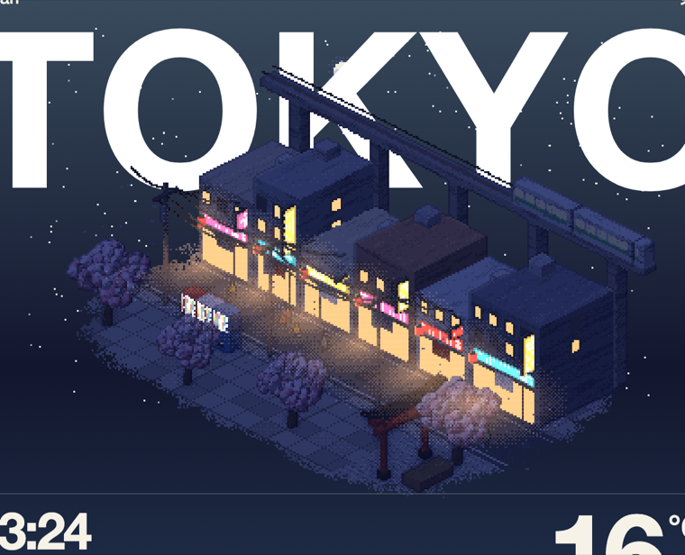
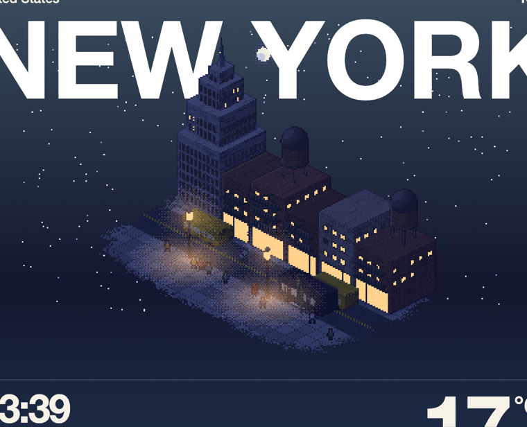
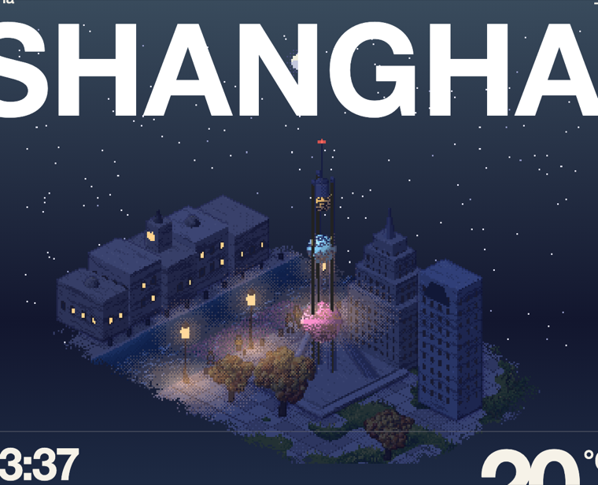
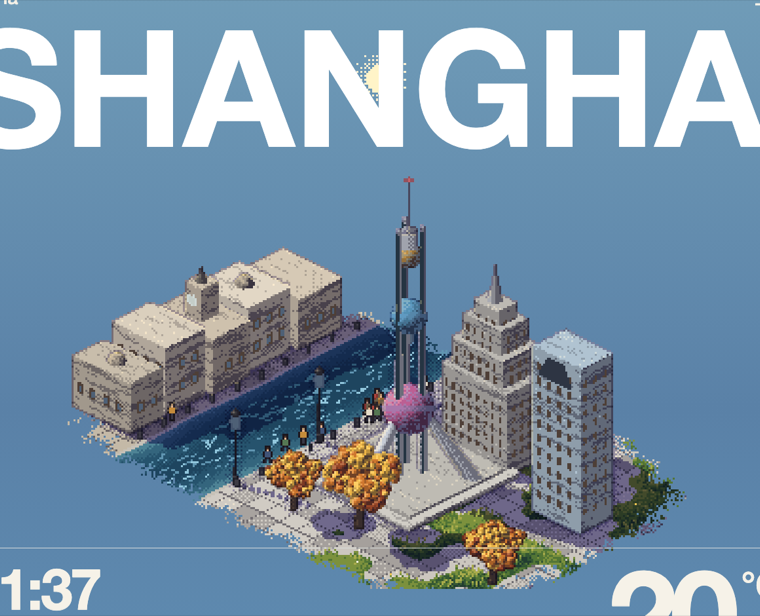

# Lo-Fi Weather 技术拆解：发光物件与八城场景

参考项目：[`amirmushichge/lofi-weather`](https://github.com/amirmushichge/lofi-weather)（MIT）
本地路径：`reference/lofi-weather/`（只读）



---

## 1. 它是什么

输入任意城市名，抓 Open-Meteo 的实时天气，把它画成一张**像素海报**：一座等距小岛，天气（晴/云/雾/雨/雪/雷暴）、时段（黎明/正午/黄昏/夜晚）、季节（春樱/夏绿/秋叶/冬雪）全部叠在同一张烘焙底图上。

8 个城市有手绘场景，其余地点复用通用广场：

| 城市 | 标志物 | 场景文件 |
|------|--------|----------|
| Mostar | 内雷特瓦河上的拱桥 + 两端石塔 | `js/cities/mostar.js` |
| London | 大本钟 + 联排砖房 + 红色双层巴士 | `js/cities/london.js` |
| Reykjavík | 阶梯式教堂 + 铁皮屋 + 港口 + 太阳航行者 | `js/cities/reykjavik.js` |
| New York | 装饰艺术塔 + 褐石排屋 + 消防梯 + 黄色出租车 | `js/cities/newyork.js` |
| Tokyo | 商店街 + 高架电车 + 鸟居 + 樱花 | `js/cities/tokyo.js` |
| Dubai | 哈利法塔 + 风塔 + 棕榈 + 阿布拉船 | `js/cities/dubai.js` |
| Singapore | 三塔空中花园 + 超级树 + 店屋 | `js/cities/singapore.js` |
| Sydney | 海港大桥 + 歌剧院 + 渡轮 | `js/cities/sydney.js` |
| **Shanghai（本项目新增）** | 东方明珠 + 黄浦江 + 外滩钟楼 | `js/cities/shanghai.js` |

画布固定 **360×280**，软件光栅化，零依赖、零构建。

---

## 2. 文件与职责

| 文件 | 行数 | 职责 |
|------|------|------|
| `js/engine.js` | 368 | 相机、深度缓冲、球/胶囊/盒、色阶、抖动、阴影、描边、草与落叶 |
| `js/scene.js` | 502 | 通用广场、房屋/家具、`plotLit`/`pane` 发光协议、共享道具、城市注册表 |
| `js/cities/shared.js` | 77 | 岛屿轮廓、路面、砖石墙面、`block()` 楼体、`vehicle()` 车辆 |
| `js/cities/*.js` | 43–238 | 每城的地面配色 + 静物 + 布局（光源、人群路径、烟囱、雪人） |
| `js/bake.js` | 66 | 烘焙静帧：地面 → 建筑 → 阴影两份底图 → 灯池 |
| `js/draw.js` | 306 | 每帧：选底图 → 动态层 → 后处理调色 → 天空/天气 |
| `js/life.js` | 311 | 行人/人群/鸽子/烟/雨雪/落叶/闪电 |
| `js/weather.js` | 238 | 天气数据 → 目标状态 `T`，缓动到 `V`；太阳时刻 |
| `js/main.js` | 41 | URL 参数、启动、帧循环 |

---

## 3. 渲染管线

```
bake()                              每帧 draw()
──────                              ──────────
地面 + 静态物体                      选底图：sunny ? shadowPix : noShadowPix
  ↓ plot / plotLit                   ↓ 草、水、雪人、人、车、落叶
记录 emit / emitZ                    ↓ 动态阴影
  ↓                                 shadeEdges()      描边
两份底图：有影 / 无影                gradeAll()        天气 + 昼夜 + 灯光
  ↓                                 drawSky()         天空层（独立 canvas）
灯池 lampPool / cafePool / flood     drawWeather()     雨雪烟闪电
                                    paintPage()       海报底色
```

关键设计：**静态场景只烘焙一次**，天气和昼夜都是逐像素后处理；阴影做成"有影/无影"两份底图，按云量和夜晚用 Bayer 抖动淡入淡出（`draw.js:286-288`）。

---

## 4. 发光物件系统（核心）

这是本项目最值得移植的部分。它**不是实时光源**，而是三层叠加：

1. **哪些像素会发光** —— 烘焙期写进 `emit` 缓冲（像素级 ID）
2. **什么时候亮** —— 每帧按夜晚/天气/钟点统一决策
3. **照亮周围** —— 烘焙期预计算 `lampPool` / `cafePool` / `flood` 三张光池，后处理加色

### 4.1 emit 缓冲：像素记住自己属于哪盏灯

```js
// js/scene.js:32-40
const emit = new Uint8Array(W * H);      // 每像素一个发光 ID
const emitZ = new Float32Array(W * H);   // 写入时的深度

// js/scene.js:81-87
function plotLit(x, y, z, c, id) {
  const p = project(x, y, z), ix = p.sx | 0, iy = p.sy | 0;
  if (... || p.d <= zb[iy * W + ix]) return;
  plot(x, y, z, c);
  emit[iy * W + ix] = id;
  emitZ[iy * W + ix] = p.d;
}
```

窗玻璃统一走 `pane()`（`scene.js:352-363`）：画框用普通 `plot`，玻璃用 `plotLit` 写入 ID。ID 就是语义：

| ID | 含义 | 典型位置 |
|----|------|----------|
| 1 | 咖啡馆橱窗 | 通用广场 |
| 2 | 路灯玻璃 | `streetLamp()` |
| 3 | 店铺暖光 | 城市店面、歌剧院玻璃幕墙 |
| 4 | 霓虹 | 超级树环、东京竖招牌 |
| 5 | 自动售货机 | 东京街角 |
| 6–9 | 招牌（粉/青/黄/红） | 东京 |
| 10–15 | 住宅窗 | 通用广场二楼 |
| 20–219 | 城市楼体窗（每扇独立） | `block()` 用 `(id + row*5 + col*3) % 200` 生成 |

烘焙结束做一次**遮挡失效**（`bake.js:34-35`）：

```js
for (let i = 0; i < W * H; i++)
  if (emit[i] && zb[i] !== emitZ[i]) emit[i] = 0;  // 被更近的物体盖住
```

这样后画的屋顶/雨棚不会留下"透出来的窗光"。

### 4.2 开灯决策：一个 smoothstep + 每小时洗牌

逐像素在 `gradeAll()` 里决定（`draw.js:68, 96-109`）：

```js
const lamps = smooth(.45, .8, Math.max(night, storm*.7 + cloud*.25 + fog*.4));
const cafeOpen = sun.m > 420 && sun.m < 1380 ? 1 : .15;

const e = still ? emit[i] : 0;   // 只对烘焙像素生效
if (e) {
  const sign = e >= SIGN_PINK && e <= SIGN_RED;
  const on = e === LAMP_GLASS || e === PROP_WARM || e === NEON ? lamps > .5
           : e === VENDING ? lamps > .25
           : sign ? lamps > .4
           : e === CAFE_WINDOW ? lamps * cafeOpen > .3
           : night > .5 && hash(e, hour) < .62;   // 普通住家窗
  if (on && e === VENDING) { pix[i] = rgb(r*.7+90, g*.7+90, b*.7+96); continue; }  // 冷白
  if (on && sign) { pix[i] = rgb(r*1.15+34, ...); continue; }                     // 招牌保色提亮
  if (on && e === NEON) { pix[i] = rgb(214,136,236); continue; }                  // 霓虹粉紫
  if (on) { const k = e === LAMP_GLASS ? .3 : (iy%3===0?.1:0) + hash(e,3)*.2;
            pix[i] = rgb(lerp(lit[0],255,k), ...); continue; }                    // 暖白
  if (night < .5) { /* 白天玻璃反天空色 */ }
}
```

三个细节值得抄：

- **`lamps` 不只看夜晚**：阴天、雷暴、雾天也会提前开灯，所以雨天街景不是灰的，而是"阴沉 + 暖灯"。
- **普通住家窗按小时随机**：`hash(e, hour) < .62`，同一个 ID 在同一小时内状态稳定，换小时重新洗牌；每扇窗 ID 不同 → 整栋楼是零散亮灯，而不是全亮/全灭。
- **发光像素 `continue`**：跳过后面的阴天去饱和、黄昏暖调、夜间压蓝，所以灯不会跟着被压暗。

### 4.3 灯池：把光"烘焙"到地面

`bake.js:49-65` 在烘焙末尾为每个光源生成一张浮点场：

```js
// 路灯：脚点周围 5 个世界单位的椭圆，灯头周围 30px 的光晕
const ground = Math.max(0, 1 - Math.hypot(dx, dy)) ** 1.6;
const halo   = Math.max(0, 1 - Math.hypot(ix - head.sx, iy - head.sy) / 30) ** 2;
lampPool[i] = Math.max(pool, zb[i] > -1e8 ? ground : 0, halo * .7);

// 咖啡馆橱窗：3.2 × 2.2 世界单位的椭圆
cafePool[i] = Math.max(0, 1 - Math.hypot(cx, cy)) ** 1.4;
```

每帧加色（`draw.js:117-123`）：

```js
const pool = Math.max(lampPool[i], cafePool[i] * cafeOpen * .85,
                      still && flood[i] ? .38 : 0);
if (pool > 0) {
  const band = Math.floor(pool * 4 + bay * .9) / 4 * lamps;  // 4 档 + Bayer
  r += band * 150; g += band * 104; b += band * 46;           // 暖黄
}
```

- **加色而非混色**，所以雪地、水面、树叶都会染上灯色。
- **4 档量化 + Bayer 抖动**，保持像素画质感，不是平滑渐变。
- **在夜间压蓝之后执行**，灯池不会被夜色吃掉。
- `flood` 是歌剧院专属泛光：绘制前后对比 `zb` 快照，凡是新增像素就标记为泛光（`sydney.js:31-35`），整栋建筑均匀 +0.38 档。

### 4.4 天空层与极光

天空是**独立的 canvas**（`#sky`），不参与场景深度（`draw.js:137-197`）：

- 星星：`hash` 稀疏采样，随夜色增强，闪烁用 `L.time`
- 日月：沿弧线走，`disc()` 用 Bayer 抖动画出圆盘与光晕
- 云：4 个椭圆 blob 组成一朵，34 朵随机分布，按云量 `show` 淡入；**靠近画布两侧会整体淡出**，避免硬切
- 极光（`reykjavik.js:90-105`）：只在高纬度（|lat| > 56）的晴朗夜晚出现；逐列噪声生成上下边界，绿色→紫色渐变，Bayer 抖动

### 4.5 动态物体的窗灯

人、车、船、列车是每帧重画的，不走 `emit`，而是绘制时直接读 `V.night`：

```js
// shared.js:43-51 车辆
const lit = V.night > .45;
plot(a, y + wid/2 + .01, z, lit ? rgb(255,230,160) : rgb(54,62,76));

// tokyo.js:114 列车；sydney.js:43 渡轮同理
```

这样列车开过时，车窗会跟着当前夜色一起亮。

---

## 5. 八城场景与它们的发光物件

| 城市 | 发光物件 | 实现锚点 |
|------|----------|----------|
| Tokyo | 店铺暖光带、粉/青/黄/红四色招牌、竖招牌、红灯笼、3 台售货机、电车车窗 | `tokyo.js:27-41, 111-124`；`scene.js:208-221` |
| London | 大本钟两个钟面整面亮、电话亭玻璃与顶部灯带、路灯 | `london.js:15-22`；`scene.js:147-157` |
| New York | 帝国大厦塔尖航空灯、褐石楼窗阵、店铺橱窗、路灯大光池、出租车窗 | `newyork.js:24-34, 50-55` |
| Dubai | 哈利法塔 11 段塔身窗、塔尖灯、风塔、棕榈 | `dubai.js:13-23` |
| Singapore | 三塔窗、空中花园、超级树环形霓虹（`NEON`）、店屋 | `singapore.js:10-20`；`scene.js:232-250` |
| Sydney | 歌剧院整栋泛光（`flood`）、渡轮窗、路灯 | `sydney.js:31-35, 39-63`；`scene.js:293-305` |
| Mostar | 桥面两端路灯、石屋窗、清真寺尖顶 | `mostar.js:85-94, 221` |
| Reykjavík | 教堂窗、铁皮屋窗、港口路灯、**极光** | `reykjavik.js:90-105` |

夜景截图（纽约）：路灯在湿冷的街面上压出两级暖色光池，商铺橱窗整条亮，楼上住家窗零散。



### 场景的其余部分

每个城市文件只做三件事，天气/灯光/人群全部复用：

```js
const SOMECITY_LAYOUT = {
  scale, lift,                     // 相机
  ground(x, y, ix, iy, i) {...},   // 每像素地面颜色（返回 0 = 天空）
  build() {...},                   // 静物（烘焙一次）
  extra() {...},                   // 每帧动态物（车/船/列车/花瓣）
  lamps: [{x, y, z, base}],        // 灯池位置
  cafe, chimney, snowman, kid,     // 生活锚点
  pigeons, tree, inside, paths,    // 鸽子/落叶源/雨雪落点/人群路径
};
```

`block()`（`shared.js:26-41`）是最常用的建筑构件：墙体 + 砖缝 + 网格窗（每扇独立 ID）+ 可选亮灯店面。新城市基本是"摆 block + 一个地标"。

---

## 6. 与本项目的对照

### 现状

`pixel-diorama-lab` 的 `demo/engine.js` 复刻的是 **Pixel Plays** 的固定光照与阴影，没有发光系统：

- 没有 `emit` 缓冲；`demo/village/houses.js` 的窗户是静态亮色，不会随昼夜变化
- Studio 光照面板只有全局环境亮度/色调/暗角与点光源，没有"发光材质"
- 灯池不存在；路灯只是静态颜色

### 可移植的次序（低风险 → 高风险）

1. **`emit` 协议**：在 `demo/engine.js` 增加 `emit`/`emitZ` 与 `plotLit()`，烘焙末尾做遮挡失效。构件通过 `ctx.emissive(id)` 声明发光面。
2. **昼夜状态**：`LIGHT.night` + `LIGHT.lamps`（复用 `smooth` 阈值），在现有后处理链末尾加 `applyNight()`。
3. **开灯决策**：窗 ID 按小时 `hash(id, hour)`；店面/路灯/霓虹固定阈值。
4. **灯池**：Studio 编辑器已有可拖拽点光源（`editor-canvas.js:66-81`），把光源列表烘焙成 `lampPool`，后处理 4 档 + Bayer 加色。
5. **泛光 `flood`**：对指定构件绘制前后做 `zb` 差分，适合塔/桥这类地标。

### 已知坑

- **`plotCapture` 回放会丢 emit**：山村树冠用 `plotCapture` 录像素后每帧回放（`demo/village/foliage.js:76-93`）。如果树冠要发光或被灯池照亮，capture 必须一并记录 emit/灯池，或在回放后补算。
- **灯池只作用于烘焙像素**：动态人物/车辆不会被灯池照亮（参考项目也是如此）；动态物要自己按 `night` 上色。
- **发光像素跳过全局调色**：这是"灯不被夜色压暗"的关键，顺序不能反。
- **ID 复用要克制**：`hash(id, hour)` 让同 ID 的窗同亮同灭；同一栋楼必须用不同 ID，否则会整排一起亮。

---

## 7. 复刻：上海 · 东方明珠

按同一套约定新增的城市文件：`reference/lofi-weather/js/cities/shanghai.js`，在 `index.html` 里注册，入口是它自己的 `registerCity`（城市 = 场景组件：地面 + 静物 + 每帧动态 + 光源 + 人群路径）。

```bash
# http://127.0.0.1:5302/?city=Shanghai&w=clear&t=night
```





### 布局

- **黄浦江**沿 y 轴穿过小岛（`SH_RIVER=-5.4`，半宽 2.5 + 岸线噪声），西岸外滩、东岸陆家嘴。
- **外滩**：5 栋 `block()` 石砌楼，中间一栋加海关钟楼（钟面整面 `plotLit(..., PROP_WARM)`，夜里亮）；屋顶穹顶/旗杆各一。
- **陆家嘴**：东方明珠在前，金茂（阶梯 `block` + 尖顶）、环球金融中心（方塔 + 顶部梯形开口）在后。删掉了上海中心，避免抢地标。
- **滨江**：3 盏路灯（进 `lamps` 灯池）、银杏/梧桐、条石步道、人群路径；江里一艘观光船来回开。

### 东方明珠的发光实现

球体不能直接用 `sphere()`（它不写 `emit`），所以写了一个 `pearlOrb()`：复制参考项目球体的着色公式，逐像素写入 `pix/zb`，并按"赤道亮带 + 56% 网格"写 `emit/emitZ`：

```js
const l = clamp(-.55*dx - .6*dy + .58*nz, 0, 1);   // 与 engine.js sphere 完全同一条光照
pix[i] = ramp[...];
if (Math.abs(dy) < .12 || hash(ix, iy) < .42) { emit[i] = id; emitZ[i] = d; }
```

三个球分别挂 `SIGN_PINK / SIGN_CYAN / SIGN_YELLOW`，开灯后整球呈粉、青、琥珀色；塔尖航空灯挂 `SIGN_RED`。

三根斜撑、三根立柱用 `capsule` + 沿柱面 `plotLit` 的青色灯带。**坑**：灯带必须画在柱面外侧（x/y 各偏移 .17），画在柱心会被柱体自己的深度挡掉，夜里塔身会整根消失。

夜间水面额外叠一层粉紫倒影（`shanghaiWater`），观光船的窗按 `V.night` 直接换色（动态物不进 emit）。

### 构图参数

| 项 | 值 | 说明 |
|----|-----|------|
| `scale` | 11.4 | 岛宽约 200px，塔高约 140px |
| `lift` | 72 | 塔顶压到海报标题以下 |
| 塔位 | `(2.4, 0.6)` | 画面前景中心 |
| 下/中/上球 | `r=1.15/0.82/0.6`，`z=3.5/8.2/11.3` | 塔总高 15.1 |
| 斜撑 | 半径 2.95 → 0.62，z 0.35 → 3.55 | 三根，120° 分布 |

同一造型也在我们自己的构件库注册为 `oriental-pearl`（`demo/kit/ref-shanghai.js`，配方卡见 `docs/kit/buildings.md`）。差异：构件库没有 emit/昼夜，球体用高饱和基色 + 固定光照表达发光感；场景版才有真正的夜间点亮与灯池。

---

## 8. 运行

```bash
cd reference/lofi-weather && node serve.mjs
# http://127.0.0.1:5302/?city=Tokyo&w=clear&t=night
```

URL 参数：`city`、`name/lat/lon`、`w`（clear/heat/cloudy/overcast/fog/drizzle/rain/downpour/storm/snow/blizzard）、`t`（dawn/noon/dusk/night）、`format`（poster/square/story/banner）、`embed=1`、`people`（sprites/crowd/none/rig）。

> `embed=1` 会忽略 `w`/`t` 预览参数（`main.js:8-11`），想强制夜景要使用非 embed 模式。
